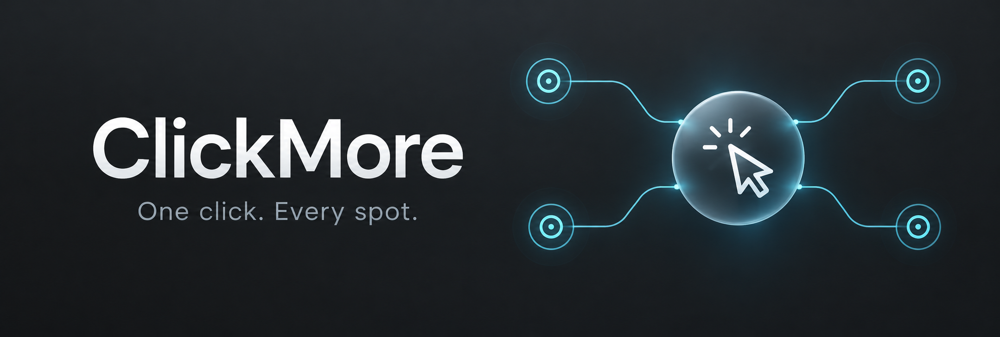
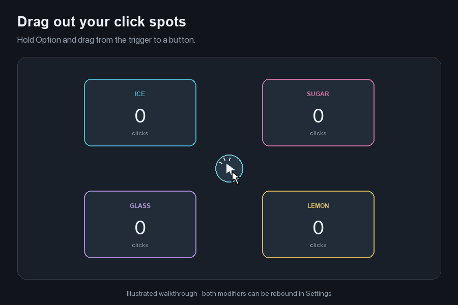
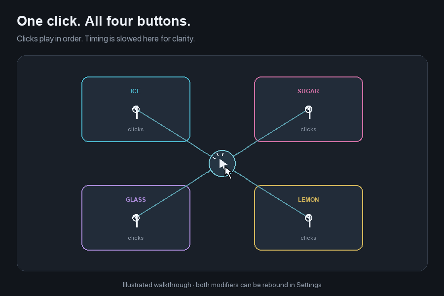
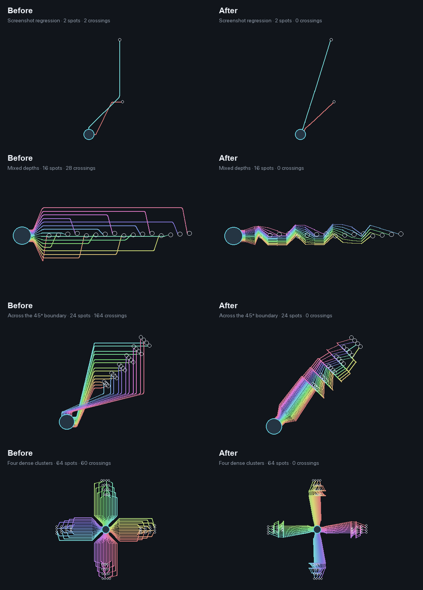

# ClickMore

[](https://github.com/HelgeSverre/clickmore/actions/workflows/ci.yml)
[](https://github.com/HelgeSverre/clickmore/actions/workflows/release.yml)


[](https://github.com/HelgeSverre/clickmore/releases/latest)

ClickMore is a native macOS menu bar app with a movable floating trigger. Place click spots over buttons in a game or another app; one trigger click clicks every spot in order, with a default 10 ms delay between clicks.

## How it works



*Illustrated walkthrough using the app's actual connector-routing code. Click timing is slowed for clarity. The header is AI-generated artwork.*

| Gesture | Result |
| --- | --- |
| Left-click the trigger | Click every connected spot once, in order |
| Option-drag from the trigger | Create a spot at the drop position |
| Drag the trigger | Move the trigger; keep spots fixed |
| Command-drag the trigger | Move the trigger and all spots together |
| Right-click the trigger | Add, arrange, or remove all spots; open Settings |

Both drag modifiers are rebindable in **Settings → Dragging**. The overlay has no main window or Dock icon; its menu bar icon opens Settings and enables or disables it.

<details>
<summary>Static overview</summary>



</details>

## Install

Requires **macOS 14 or later**, on Apple Silicon or Intel.

### Homebrew

```sh
brew install --cask helgesverre/tap/clickmore
open -a ClickMore
```

To update: `brew update && brew upgrade --cask clickmore`. To uninstall: `brew uninstall --cask clickmore`. Your saved layout is kept.

### Installer or ZIP

Download **[the latest release](https://github.com/HelgeSverre/clickmore/releases/latest)**. Open the universal **PKG** and follow Installer to install ClickMore in `/Applications`. The installer asks for administrator authentication. Alternatively, extract the **ZIP** and drag `ClickMore.app` into Applications. Both downloads contain the same Developer ID signed app, notarized by Apple with its ticket stapled for offline verification. SHA-256 checksums are included with each release.

On first use, open **ClickMore → Settings** from the menu bar, choose **Open Accessibility Settings**, and enable ClickMore in **Privacy & Security → Accessibility**. This permission lets it send mouse clicks to other apps. The permission indicator updates automatically.

### Build from source

Requires **Swift 6** (Xcode 16 or newer, or equivalent command line tools). Check with `swift --version`.

```sh
git clone https://github.com/HelgeSverre/clickmore.git
cd clickmore
./script/build_and_run.sh --build

mkdir -p "$HOME/Applications"
ditto dist/ClickMore.app "$HOME/Applications/ClickMore.app"
open "$HOME/Applications/ClickMore.app"
```

You can also download the source from **Code → Download ZIP**.

The build script creates and signs `dist/ClickMore.app`. It uses an installed Apple Development signing identity when available, or an ad hoc signature otherwise. Set `CLICKMORE_SIGN_IDENTITY` to choose another identity. Keep the app at a consistent location and use the same signing identity for updates to help preserve Accessibility approval.

To update, pull the latest code, repeat the build and copy steps, then reopen the app. For development, `./script/build_and_run.sh` builds and launches the copy in `dist/` directly.

ClickMore launches as a floating overlay with a menu bar icon and no Dock icon or main window. Open Settings using the cursor icon in the menu bar, or Command-comma while a ClickMore settings or test window is active. The overlay uses transparent, borderless, nonactivating macOS panels.

## Place and use click spots

1. Drag the floating trigger to a convenient gap between the buttons.
2. Hold **Option**, drag out from the trigger onto a button, and release to create a ready-to-use click spot. Repeat for each button. Change the modifier in **Settings → Dragging → Drag out a new spot with**.
3. For manual arrangement, right-click the trigger and choose **Add Click Spot** or **Arrange Click Spots**. Drag the target rings onto buttons, then click the checkmark on the trigger or choose **Finish Arranging**.
4. Left-click the trigger to click each spot once. Spots and connecting lines pass mouse input through to the underlying app outside placement mode.

Right-click a spot while arranging to remove it or change its click order. Plain dragging moves only the trigger. **Command-drag** moves the trigger and every spot together, keeping their relative positions; rebind this separately in **Settings → Dragging → Move all spots with the trigger**. The two gestures use distinct modifiers.

**Remove All Click Spots** is available from the trigger's context menu and the menu bar. The menu bar also provides an **Enabled** toggle that hides the overlay and cancels an active sequence. Option-drag follows the macOS [copy-by-dragging convention](https://support.apple.com/en-gb/guide/mac-help/mh35852/mac); Shift, Command, and their combinations are also available. Control-click keeps its normal context menu behavior.

The overlay uses an icon-only native material button, small target rings, and translucent circuit-style connections with rounded bends. Routing uses angular groups, separate attachment points, and ordered lanes inspired by [ELK's edge spacing](https://eclipse.dev/elk/reference/options/org-eclipse-elk-spacing-edgeEdge.html) and [port spacing](https://eclipse.dev/elk/reference/options/org-eclipse-elk-spacing-portPort.html). It aims for 10-point separation, with more clearance around larger editing targets. Spacing compresses where the geometry cannot fit it, and lines converge at overlapping targets. Click positions and click order stay fixed.

VoiceOver announces the trigger's state and each spot's order and position. Its Actions menu provides adding, arranging, moving the trigger or whole layout, reordering, and removing spots. The overlay respects Reduce Transparency and Increase Contrast. While Settings has focus, the overlay passes mouse input through so it cannot cover a Settings control.

In Settings, choose **Open Accessibility Settings** and allow **ClickMore** under **Privacy & Security → Accessibility**. macOS requires this approval to post clicks into other apps. The app checks permission again automatically; a grey trigger indicates access is still missing.

Settings also control the delay from 1–250 ms, trigger size, opacity, connecting lines, and pointer restoration. Each click has a 2 ms press before release, so the default four-click batch takes roughly 38 ms plus operating-system scheduling. The pointer returns after the sequence if it has stayed at the last target.

Layouts and preferences are saved automatically to `~/Library/Application Support/ClickMore/layout.json`. Targets use absolute screen positions in points. Rearrange them if the game moves or changes size. Targets on a disconnected display are skipped, and the trigger is recovered onto a connected display.

## Try the four-button board

Open **Four-Button Test Board** from the menu bar, click **Place Trigger & Four Spots**, then click the floating trigger. Ice, Sugar, Glass, and Lemon should each increment once. Closing the board restores the layout you were using before the test. This test layout is temporary and does not overwrite your saved game layout.

## Verify and develop

```sh
swift test
./script/test_runtime.sh
./script/test_runtime.sh --integration-test
```

The unit tests cover press/release ordering, timing, cancellation, concurrent triggers, permission checks, persistence, display coordinates, group translation, and connector routing. The routing suite exercises eight fixed stress cases and 50 reproducible random clusters with up to 64 targets, in both normal and editing modes. It checks crossings, finite geometry, endpoint placement, order independence, and translation stability. Rounded corners get a separate crossing regression check; their radius shrinks when lanes are crowded.

The local runtime test delivers AppKit events to the live test board without requiring Accessibility. The integration test requires Accessibility and launches a separate test-target app. It verifies system clicks into that process, a left-click routed through the floating trigger, preservation of the target app's focus, both rebindable drag gestures, plain dragging, clear-all, and Settings pass-through. Reports go to `test-results/`. GitHub Actions runs the unit tests and builds the app on macOS.

<details>
<summary>Connector routing stress tests: before and after</summary>



The diagrams show exported routing geometry, not desktop screenshots. Reproduce the current geometry and README animation with Swift and Python 3 with Pillow installed:

```sh
./script/generate_readme_media.sh
```

The baseline captures the routing from commit `7820be3`.

</details>

The build script supports `--build`, `--verify`, `--debug`, `--logs`, and `--telemetry`. The Codex Run action invokes the same script. Regenerate the app icon with:

```sh
swift script/generate_icon.swift .build/ClickMore.iconset
iconutil -c icns .build/ClickMore.iconset -o Resources/ClickMore.icns
```

`ClickMoreCore` owns the layout, persistence, screen geometry, and cancellable click sequencer. `ClickMore` uses SwiftUI for Settings and AppKit for the menu bar, nonactivating overlay panels, and test board. Clicks use the [Core Graphics event API](https://developer.apple.com/documentation/coregraphics/cgevent); its [posting permission check](https://developer.apple.com/documentation/coregraphics/cgpreflightposteventaccess()) controls the permission indicator.

## Build and publish a release

GitHub Actions builds and publishes signed releases automatically when a version change in `Resources/Info.plist` is pushed to `main`. You can also run **Signed release** from the Actions tab to retry or release the current version.

1. Update `CFBundleShortVersionString` and `CFBundleVersion` in `Resources/Info.plist`.
2. Commit and push to `main`.
3. The workflow runs tests, builds for Apple Silicon and Intel, signs with Developer ID, notarizes the app and PKG, staples Apple's tickets, verifies both downloads, publishes a GitHub release and tag, and updates the Homebrew cask.

Published versions are immutable. Retries download and verify existing artifacts before retrying the tap update. Use a new version for a new build. Release runs are serialized and only run from `main`; pull requests run the separate build-and-test workflow without release secrets.

The repository's encrypted Actions secrets hold `APPLE_APPLICATION_CERTIFICATE_BASE64`, `APPLE_APPLICATION_CERTIFICATE_PASSWORD`, `APPLE_INSTALLER_CERTIFICATE_BASE64`, `APPLE_INSTALLER_CERTIFICATE_PASSWORD`, `APPLE_NOTARY_KEY_BASE64`, and `CLICKMORE_TAP_DEPLOY_KEY`. Notarization uses the same App Store Connect team API key convention as Splash, Memory Left, and Space Left. Repository variables store `APPLE_APPLICATION_SIGNING_IDENTITY`, `APPLE_INSTALLER_SIGNING_IDENTITY`, `APPLE_NOTARY_KEY_ID`, and `APPLE_NOTARY_ISSUER_ID`. The workflow imports signing credentials into a temporary Keychain, writes the API key to a private temporary file, and removes both afterward. The tap uses its own repository-scoped write deploy key; GitHub's per-run token publishes the app release. Never commit private keys or passwords.

Artifacts go to `dist/releases/<version>/`. Installer relocation is disabled so updates go to `/Applications` even if a development copy exists elsewhere. The package installs only the app; it needs no installer scripts or extra entitlements.

Local releases remain supported: run `CLICKMORE_NOTARY_PROFILE=your-profile ./script/package_release.sh`, then `./script/publish_release.sh` with GitHub CLI authenticated. The Mac needs Xcode, Developer ID Application and Installer identities (including private keys), and a [notarytool Keychain profile](https://developer.apple.com/documentation/security/notarizing-macos-software-before-distribution). The default profile is `clickmore-notary`; an ignored `.clickmore-release.json` file can remember a different profile as `{"notaryProfile":"your-profile"}`. Environment variables take precedence.

To test an installed release with the existing runtime harness:

```sh
CLICKMORE_TEST_APP=/Applications/ClickMore.app ./script/test_runtime.sh --integration-test
```

Some games reject synthetic input or require a longer delay; adjust the delay in Settings if necessary.
